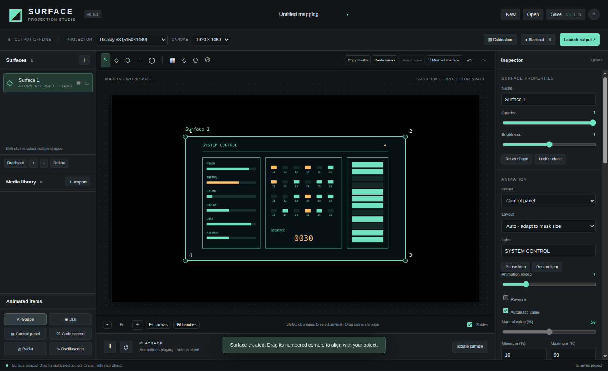
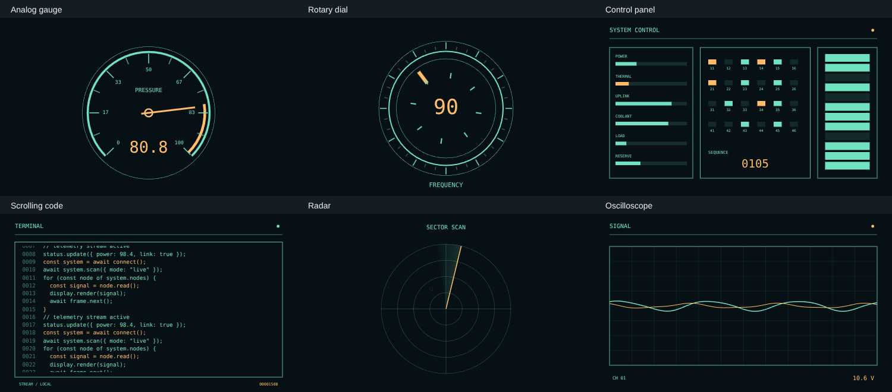
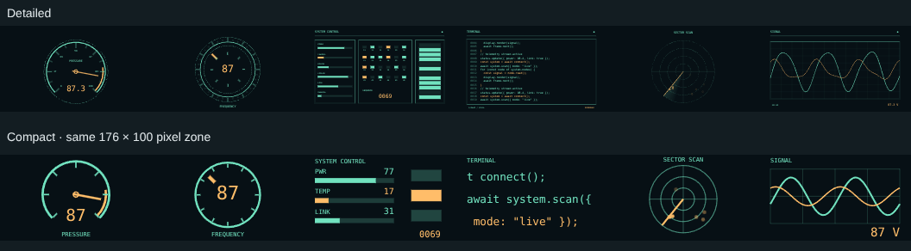
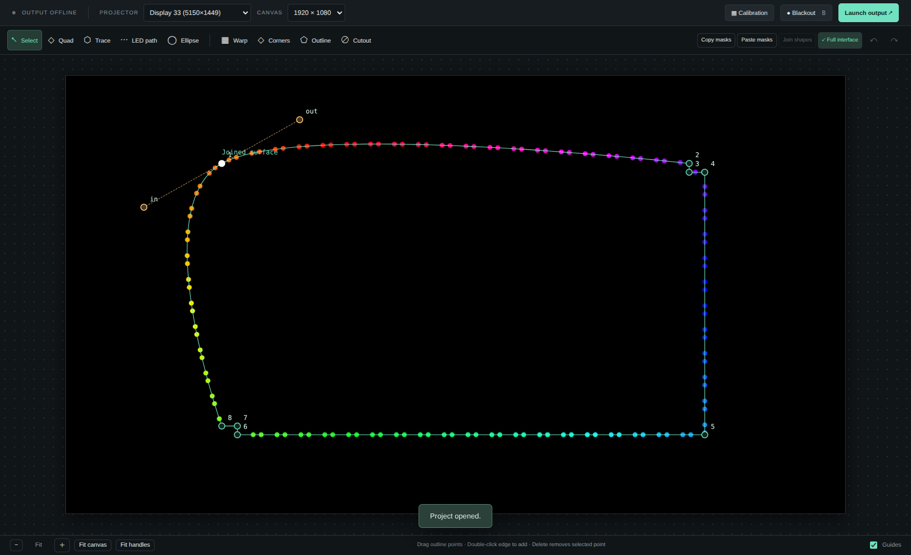

# Basic how-to

[Back to README](../README.md)

## Install and launch

Install Node.js 22 or newer and Git, then open a terminal:

```sh
git clone https://github.com/bizzomephisto/projectionmap.git
cd projectionmap
npm ci
npm start
```

The repository is private, so GitHub must be signed in or Git must be authenticated for cloning. After dependencies are installed, the included `launch-linux.sh` or `launch-windows.cmd` can also launch the app. They prefer a local packaged build when one exists.

To create a standalone package, run `npm run dist:linux` on Linux or `npm run dist:windows` on Windows. Packages are written to `release/0.6.2/`. Installers are unsigned; Windows hardware validation is still outstanding.

## Map a surface

1. Connect the projector as an **extended display** in your operating system.
2. In Surface, choose the output under **Projector** and set **Canvas** to the intended output resolution. Click **Launch output**.
3. Add a **Quad**, **Ellipse**, or **Trace**. For a trace, click the outline points and press Enter to finish.
4. Turn on **Calibration**. Drag the numbered corners while watching the projected object. Use **Warp** for curved surfaces and **Outline** for individual trace points.
5. Turn off Calibration to see content. Import an image/video and click its **＋**, add text/color, or choose an animated item.
6. Save the project. Keep its `.surface.json` file and adjacent `.assets` folder together.

The projector shows content without editor handles. **B** toggles blackout; Escape closes the output window. **Tab** toggles the minimal interface.



## Add animated gauges, panels, or code

1. Select the mask that should contain the item.
2. Click a preset in **Animated items** in the left sidebar: Gauge, Dial, Control panel, Code screen, Radar, or Oscilloscope. With no surface selected, the app creates one.
3. In **Animation**, adjust the label, speed, direction, colors, and background. For gauges/meters, leave **Automatic value** on to animate between Minimum and Maximum, or turn it off and set **Manual value**.
4. Set **Layout** to **Auto**, **Compact**, or **Detailed**. Auto uses Compact when the item's shorter projected edge is below 220 output pixels. Use Compact for small physical zones: larger numbers, bolder strokes, fewer indicators, and fewer code rows. Editor zoom does not change this choice.
5. For a code screen, edit **Scrolling text**. This is display-only text; it never executes. **Detail / density** controls row density.
6. Use **Pause item / Restart item** for one layer. The bottom transport controls all animated items, LEDs, and videos together.

Use **Duplicate** to copy a mask with its animation and settings. **Copy masks / Paste masks** deliberately copies geometry without content. You can also add several content layers to one mask; select the desired layer in the inspector to edit it.





## Add an animated LED strip

1. Choose **LED path**, click two or more points, then Enter for an open strip. Shift+Enter closes a loop. To reuse a closed trace, select it and click **Apply LEDSTRIP** instead.
2. Select a path point and click **Make Bézier**. Drag the gold tangents to curve the run; linked tangents keep a smooth joint.
3. Enter the measured projected path length in inches, then set **LEDs per inch**. The initial pixels-per-inch estimate is not a physical calibration.
4. Choose dots, blocks, or a continuous strip, then set width, colors/palette, effect, speed, and intensity.
5. Use **Restore mask content** to return to retained media or to add an animated content preset.

Connected joined traces can become strips directly. Disconnected outlines need separate paths. The effects are local WLED-style projection animations, with no physical controller connection.



## Common adjustments

| Goal | Control |
| --- | --- |
| Keep a mask and remove its media | **Remove media** or **Clear all content** |
| Resize/mirror/rotate a whole surface | **Transform active surface** |
| Resize/move content within a fixed mask | Selected layer's scale, rotation, and offset controls |
| Make a small widget readable | **Layout → Compact**, fewer details, or a larger physical zone |
| Recover a handle off-screen | **Fit handles** / Home, or drag its edge indicator |
| Hide panels to enlarge the workspace | **Minimal interface** / Tab |
| Restore missing media | **Relink** in Media library |

Animations use simulated values. Videos are silent. Saved projects retain settings and reopen with animation time reset. Very small labels still need enough projector pixels to be readable.
